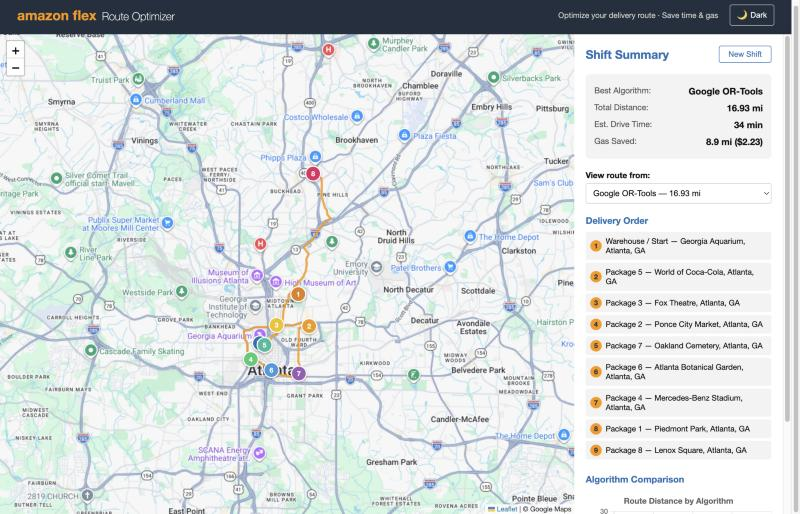

# Amazon Flex Route Optimizer

A web application that optimizes delivery routes for Amazon Flex drivers using multiple TSP (Traveling Salesman Problem) algorithms, visualized on an interactive map.

**Architecture:** Decoupled frontend + backend.
- **Frontend** — static site (HTML/CSS/JS + Leaflet.js), deployed on Vercel
- **Backend** — FastAPI (containerized with Docker), deployed on AWS EC2
- **Google Maps Platform APIs** — geocoding, driving distances, route geometry

## Findings

I ran every solver in the app on 100 delivery shifts (25 each of 7, 15, 25
and 40 stops) drawn from 41 public Atlanta places, scored on real driving
distances fetched once from Google. That made 1,000 routes. Brute force gives
the true optimum at 7 stops. Above that, the best route is the shortest any
solver found, usually OR-Tools given 30 seconds.

| Solver | Mean distance over the best route (7 / 15 / 25 / 40 stops) | Best route found | Time at 40 stops |
|---|---|---|---|
| **Google OR-Tools (open route)** | **0.0% / 0.0% / 0.0% / 0.1%** | **96 of 100** | 5.0 s |
| 2-opt | 1.2% / 4.7% / 4.5% / 5.8% | 25 of 100 | 8.6 ms |
| Nearest neighbor (driving by eye) | 11.9% / 21.8% / 22.7% / 21.3% | 2 of 100 | 0.05 ms |
| OR-Tools before the fix (round trip) | 19.5% / 10.2% / 5.2% / 6.2% | 9 of 100 | 5.0 s |


1. **OR-Tools found the best route on 96 of 100 shifts** and never lost to
   2-opt (75 wins, 25 ties). On every 7-stop shift it matched brute force.
2. **Against driving by eye, the optimizer saves 17% of a full shift.**
   That's about 11 miles, 22 minutes and $2.78 of fuel on 40 stops, compared
   with always going to the nearest stop next. Against the random entered
   order the saving looks far bigger (43–75%), but that mostly measures how
   bad a random order is.
3. **OR-Tools used to lose to the greedy heuristic.** Its routing model
   plans a loop back to the depot, and the app dropped the return leg
   afterwards. So it optimized the drive home, and on 7-stop shifts it was
   19.5% off the optimum. A one-line fix (legs back to the start cost 0)
   took that to 0.0%. More in the
   [blog post](docs/blog/the-solver-that-planned-a-round-trip.md).
4. **Most of OR-Tools' 5 seconds buys nothing.** Up to 15 stops, 0.2 s finds
   the same routes, and at 40 stops 1 s is within 0.2%. Brute force solves 7
   stops exactly in under 2 ms.

The method, every table and the limitations are in
[bench/results/findings.md](bench/results/findings.md). Generated tables
and raw routes are in [bench/results](bench/results/results.md).

### The numbers

| Measure | Result | How |
|---|---|---|
| Distance saved vs. driving by eye | 10% (7 stops) to 18% (25 stops); 11.1 mi per 40-stop shift | OR-Tools vs nearest neighbor, paired over 25 shifts per size |
| Optimality | 25 of 25 seven-stop shifts optimal; 96 of 100 overall match the best route found | vs brute force (7 stops) and OR-Tools at 30 s |
| Google Maps requests, 40 stops | 71 per optimize call: 41 geocodes, 22 Distance Matrix (1,681 elements, ≤100 each), 8 Directions | backend request code run against a stubbed network ([api_calls.py](bench/api_calls.py)) |
| Road asymmetry | 795 of 820 place pairs differ by direction; 205 by more than 10% | the fetched 41 x 41 matrix |
| Response time | OR-Tools fixed at 5.0 s; nearest neighbor and 2-opt under 10 ms at 40 stops | median wall-clock per shift |

## Demo

The app's "Try a Demo Shift" button, then a full 40-stop shift, replayed in
the terminal on the saved road distances with
[`scripts/demo.py`](scripts/demo.py) (about 25 seconds, no API calls):



The same demo shift in the app. OR-Tools' route is 16.93 mi, and the shift
summary shows 8.9 mi ($2.23) saved against the entered order. Stop 6 is the
mis-geocoded Botanical Garden from finding 7 in the
[findings](bench/results/findings.md):



## Features

- **Address input** — Enter a starting point (warehouse/home) and up to 40 delivery stops, or upload a CSV
- **Google Maps integration** — Real geocoding, driving distances, and route geometry via Google Maps Platform APIs
- **Interactive map** — Leaflet.js with Google Maps tiles, custom package markers, route polyline
- **4 TSP algorithms:**
  - Brute force (optimal but O(n!) — only up to 7 stops plus the start)
  - Nearest neighbor (greedy heuristic, O(n²))
  - 2-opt local search (improves nearest neighbor with edge swaps)
  - Google OR-Tools (industry-standard constraint programming solver)
- **Original route comparison** — See how much you save vs. the order you entered
- **Open TSP** — Route ends at the last stop instead of returning to the warehouse, saving unnecessary driving
- **Algorithm comparison** — Bar chart comparing distance and computation time
- **Shift summary** — Total distance, estimated drive time, gas savings
- **Click-to-navigate** — Click any stop in the delivery order list to zoom to it on the map
- **Segment view** — Clicking a stop shows only the route segment from that stop to the next, centered on screen; a "Show full route" button restores the complete view
- **Marker separation** — Stops that are geographically close are automatically spread apart on the map so none are hidden behind another
- **Dark/Light theme** — Toggle between themes, saved across sessions
- **Amazon Flex-style UI** — Navy/orange color scheme, "Package 1, 2, 3..." labels

## Tech Stack

| Component | Technology |
|-----------|------------|
| Backend | Python + FastAPI, Uvicorn |
| Algorithms | Custom Python implementations + Google OR-Tools |
| Container | Docker |
| Frontend hosting | Vercel (static) |
| Backend hosting | AWS EC2 |
| Map | Leaflet.js + Google Maps tiles |
| Geocoding | Google Maps Geocoding API |
| Distance Matrix | Google Maps Distance Matrix API |
| Route Geometry | Google Maps Directions API |
| Charts | Chart.js |
| Styling | Custom CSS (Amazon Flex theme + dark mode) |

## Project Structure

```
amazon-flex-optimizer/
├── backend/                     # FastAPI backend (Docker → AWS EC2)
│   ├── Dockerfile
│   ├── main.py                  # FastAPI app: /optimize endpoint + CORS
│   ├── requirements.txt
│   ├── osm_utils.py             # Google Maps API utilities (geocoding, distance matrix, directions)
│   └── algorithms/
│       ├── __init__.py
│       ├── base.py              # Shared utilities (route distance calculation)
│       ├── brute_force.py       # O(n!) optimal solver (≤8 stops)
│       ├── nearest_neighbor.py  # O(n²) greedy heuristic
│       ├── two_opt.py           # Local search improvement
│       └── ortools_solver.py    # Google OR-Tools constraint programming solver
├── frontend/                    # Static site (→ Vercel)
│   ├── index.html               # Main page with theme toggle + next-stop panel
│   ├── app.js                   # Frontend logic, Leaflet map, segment view, marker separation
│   ├── style.css               # Amazon Flex theme + dark mode + next-stop panel
│   └── vercel.json
├── bench/                       # Solver benchmark (offline after one fetch)
│   ├── places.txt               # 41 public Atlanta places
│   ├── fetch_matrix.py          # One-time Google fetch → data/atlanta.json
│   ├── run.py                   # Every solver on 100 sampled shifts → results/runs.csv
│   ├── api_calls.py             # Counts Google requests per optimize call (stubbed network)
│   ├── analyze.py               # results.md, summary.json, charts
│   └── results/findings.md      # What the benchmark found
├── scripts/demo.py              # Terminal demo; --record writes docs/demo.svg
├── docs/                        # Blog post, demo recording, screenshots
└── Makefile                     # make help lists every command
```

## Setup

### Prerequisites

1. A Google Maps API key with these APIs enabled:
   - Geocoding API
   - Distance Matrix API
   - Directions API
   - Maps JavaScript API (for map tiles)

2. **Use two separate API keys** (important for a public deployment):
   - **Server key** — used by the backend for Geocoding / Distance Matrix / Directions. Restrict by the EC2 instance's IP address. Never exposed to the browser.
   - **Browser key** — used by the frontend only for map tiles. Restrict by HTTP referrer (your Vercel domain).

### Quick start with make

With `GOOGLE_MAPS_API_KEY` in `backend/.env`:

```bash
make dev            # API on :8000 + frontend on :5500 (Ctrl-C stops both)
make demo-offline   # terminal demo on saved distances, no API calls
make bench          # rerun the solver benchmark offline (~8 min)
```

`make help` lists the rest (Docker, deploys, `make bench-fetch` to refetch
the distance matrix). The manual steps:

### Backend (local)

```bash
cd backend
python3 -m venv venv
source venv/bin/activate  # On Windows: venv\Scripts\activate
pip install -r requirements.txt

# Create .env in backend/ with your SERVER key:
echo "GOOGLE_MAPS_API_KEY=your_server_api_key" > .env

uvicorn main:app --reload --port 8000
```

API docs available at http://localhost:8000/docs

### Frontend (local)

The frontend is plain static files, deployed separately from the API:

1. Edit `frontend/index.html`:
   - Set `GOOGLE_MAPS_API_KEY` to your browser key
   - Set `API_BASE_URL` to `http://localhost:8000`
2. Serve the folder (e.g. VS Code Live Server on port 5500 — CORS is pre-configured for it)

## Deployment

### Backend → Docker → AWS EC2

```bash
cd backend
docker build -t flex-api .

# Run locally to test:
docker run -d -p 8000:8000 -e GOOGLE_MAPS_API_KEY=your_server_key flex-api
```

On EC2 (Ubuntu, t3.micro):

1. Open security group ports: 22 (SSH), 80 (HTTP), 443 (HTTPS)
2. Install Docker: `curl -fsSL https://get.docker.com | sh`
3. Build & run the container (bind to localhost only — Caddy will proxy):

```bash
docker build -t flex-api .
docker run -d -p 127.0.0.1:8000:8000 -e GOOGLE_MAPS_API_KEY=your_server_key flex-api
```

4. **HTTPS via Caddy** (required — browsers block `https://` pages calling `http://` APIs). Point a domain (e.g. a free duckdns.org subdomain) at the EC2 Elastic IP, then run Caddy:

```
flex-api.yourname.duckdns.org
reverse_proxy localhost:8000
```

Caddy automatically obtains and renews a Let's Encrypt certificate.

5. Update `ALLOWED_ORIGINS` in `backend/main.py` to your Vercel domain, rebuild, and restart the container.

### Frontend → Vercel

```bash
cd frontend
# Edit index.html first:
#   - GOOGLE_MAPS_API_KEY = your browser key
#   - API_BASE_URL = https://flex-api.yourname.duckdns.org
npx vercel          # preview deploy
npx vercel --prod   # production
```

### Final checklist

- [ ] Server key restricted to EC2 Elastic IP (Geocoding / Distance Matrix / Directions only)
- [ ] Browser key restricted to your Vercel domain (Maps JavaScript API only)
- [ ] `API_BASE_URL` in `frontend/index.html` points to your HTTPS domain
- [ ] `ALLOWED_ORIGINS` in `backend/main.py` contains your Vercel domain
- [ ] Billing alert / spending cap set in Google Cloud Console

## How to Use

1. Enter your starting address (e.g., "123 Main St, Atlanta, GA")
2. Enter delivery stops (one address per line, up to 40) or upload a CSV
3. Click "Optimize Route"
4. View the optimized route on the map with all stops marked
5. Switch between algorithms using the dropdown to compare results
6. Click any stop in the "Delivery Order" list to zoom to it on the map
7. Click a stop to see the **Next Stop panel** with the route segment from that stop to the next one highlighted on the map; click "Show full route" to return to the complete view
8. Check the shift summary for distance, time, and gas savings
9. Toggle dark/light theme with the button in the header

## CSV Format

```csv
123 Main St, Atlanta, GA
456 Oak Ave, Atlanta, GA
789 Pine St, Atlanta, GA
321 Elm Dr, Atlanta, GA
```

First line = starting point, remaining lines = delivery stops.

## Theoretical Background

The Traveling Salesman Problem (TSP) asks: *given a list of locations and distances between them, what is the shortest possible route that visits each location exactly once and returns to the origin?*

TSP is **NP-complete**, proven by reduction from the Hamiltonian Cycle problem. This means:
- **Brute force** checks all n! permutations — works for n ≤ 10 but becomes infeasible
- **Heuristics** (nearest neighbor, 2-opt) trade optimality for speed
- **OR-Tools** uses constraint programming with guided local search — the industry-standard approach

This project solves the **open TSP variant**: the route starts at the warehouse and ends at the last delivery stop without returning to the warehouse, which better models a real Amazon Flex shift.

This project demonstrates that tradeoff in practice: brute force finds the optimal route for small inputs, while heuristics and OR-Tools scale to larger problems with good (but not perfect) solutions.

## APIs Used

- **Google Maps Geocoding API** — Converts addresses to lat/long coordinates
- **Google Maps Distance Matrix API** — Computes real driving distances between all stops (batched to respect API limits)
- **Google Maps Directions API** — Returns the actual driving route geometry (polyline), split into segments for routes with 25+ stops

All require a Google Maps API key set in the `.env` file.